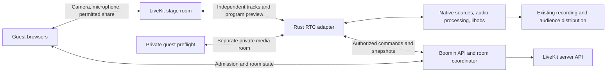

**LiveKit guest refactor — implementation plan for review, October 9, 2026.**

Status: revised after the [October 9 source review](./LIVEKIT-GUEST-REFACTOR-REVIEW-2026-10-09.md). The verdict is ready for G0/G1 prototype, with broader integration gated on measured synchronization and speakerphone AEC. All five findings are incorporated below; their implementation and physical acceptance remain open. No LiveKit migration, native AEC fix, provisioning, deployment or live acceptance test has been performed by this planning work. The measurements below are proposed release gates, not current results.

**1. Decision and product outcome**

Use LiveKit Cloud for the first hosted interactive stage, LiveKit JavaScript in guest browsers, and LiveKit Rust inside Producer's native media adapter. Retain Rust/Tauri/libobs for sources, sets, filters, mixing, composition, local recording and distribution. Keep Boomin's existing Workers, room access rules, database and Durable Objects for admission and production control. Add room-correlated telemetry and usage accounting. Consider self-hosted LiveKit only after measuring actual usage and operational requirements.

The product outcome is a guest who can join from a phone, use its speakers, converse naturally, share permitted media and recover from a network change without losing their place in the show. The host must hear each voice once. The audience recording must contain the intended full mix. Existing authored sets and native camera filters must survive room exit and guest reconnection.

The first production envelope is one native host and three simultaneous stage guests for five hours. Qualify four and eight guests separately before raising capacity. Eight guests plus unlimited screen shares, backstage previews and observers is not an implied limit. Start with Apple Silicon and the existing engine-enabled Windows build. Intel Mac and Linux production support require their own engine-enabled packaging and runtime gates; a cross-platform RTC SDK does not supply the missing compositor package.

This supersedes the hosted default proposed in the older [September guest plan](./GUEST-INFRASTRUCTURE-PLAN.md). The existing transport remains available during migration and for self-hosted compatibility. Do not silently move an active production between transports.

**2. Verified baseline and evidence boundaries**

The inspected native release checkout is `producer-release-0.4.66`, currently version 0.4.69, with HEAD `5723335`. The historical directory name is not the app version. The hosted web checkout matched the production version recorded in the [October infrastructure audit](./HOSTED-GUEST-INFRASTRUCTURE-AUDIT.md). That audit records production API deployment identifiers and its lack of an ICE_SERVERS override. Recheck deployment drift at implementation start.

Current guest video/audio enters one CEF source per guest through custom direct WebRTC. Native MonitorSender sends a separately negotiated program return to each guest. Other guest voices arrive through an audio mesh. Public STUN is the audited default; the room-session response also omits ICE configuration. Boomin's browser Live studio uses RealtimeKit separately and must not be accidentally rewritten as part of this refactor.

Current code already contains capture cleanup, fresh signaling sessions, program-readiness retries, ICE restarts, incoming video health checks and stage/mute enforcement. Native audio bus 0 carries the audience mix; bus 1 excludes remote guests. Guest pages request browser AEC and mute self/program video. These protections are foundations to preserve, not features to rediscover.

The native integration creates OBS microphone sources and monitors remote voices through OBS. The inspected integration has no explicit microphone AEC path supplied with actual speaker playback. A guest's voice can therefore potentially travel through the host's speakers and microphone into the return bus. This is a plausible mechanism, not a measured diagnosis of a past call. No WAN, mobile-carrier, five-hour or speakerphone acceptance result exists from this planning work.

An older checkpoint reports successful TURN provisioning; the later deployed-version audit found no configured override in the current guest service. Treat those as different deployment observations. Verify the active source and bindings instead of assuming the historical provisioning still works.

**3. System ownership and transport boundary**

| System | Owns | Must not become |
| --- | --- | --- |
| Existing database and room control | Durable admission, grants, desired/applied stage state, run identity, producer lease and transport assignment | A per-frame media relay |
| Room coordinator | Ordered control commands, reconciliation and pushed snapshots | A second independent permission model |
| LiveKit | Publications, subscriptions, media transport and network recovery | The authority for sets, guest admission or production ownership |
| Native adapter | Track lifecycle, clocks, buffers and RTC publication | A compositor or UI state store |
| Native audio engine | Capture/playback ownership, AEC, routing and speaker reference | A second automatic playback path |
| libobs | Production sources, effects, composition and intended output mix | A source recreated whenever a track SID changes |
| React/Tauri UI | Intent, status, controls and low-rate diagnostics | A transport for continuous high-rate PCM or frames |

A LiveKit participant identity is application supplied; its SID and track SIDs are connection/publication identifiers. Duplicate identities can disconnect an existing connection. Use application authority to decide which connection may join instead of treating “last connection wins” as host ownership. [Participant model](https://docs.livekit.io/intro/basics/rooms-participants-tracks/participants/).

Persist a stable participant/admission ID within a production run. Bind camera, microphone and screen roles to stable Producer source IDs. Replace the runtime track attached to a source on republish. Preserve transform, crop, visibility, fader, filters and set-slot binding. When a real admission ends, release occupancy deliberately; a new admission must not inherit another person's identity merely because it occupies the same authored slot.

Keep LiveKit credentials and SIDs outside authored set/protocol JSON. A saved production describes sources and bindings; an ephemeral media session resolves them to a provider. Define a narrow GuestTransport interface with connect, disconnect, publication/subscription intent, media events and diagnostics. Implement legacy and LiveKit adapters; do not build a universal provider framework before either path works.

**4. Session contract, control consistency and host ownership**

Extend existing host registration and guest session routes with a versioned manifest. Use the native host's advertised capabilities and an explicit cohort assignment to select the transport. Older hosts remain legacy. Both browser guest entry pages consume the same session/controller contract.

Proposed manifest fields: `schema_version`, logical `room_id`, `run_id`, pinned `transport`, provider room name, stable participant ID, RTC identity, host lease epoch, control revision, role/capabilities, allowed source roles, required client version, endpoint URL and ephemeral join token. Return tokens in authenticated response bodies; do not store them in set files, analytics or persistent invite URLs. The backend chooses the room, identity and privileges; client-supplied values are requests, not authority.

Reuse `room-access.ts` and participant grants. Mods may retain their authorized room controls without becoming the native production owner. A producer lease separately identifies the process allowed to publish the room program and apply native production commands. Every command carries request ID, expected control revision and, where relevant, lease epoch. Retrying a command must not repeat admission, stage accounting or contribution settlement.

The inspected `setStage` reads a version, increments it and writes it without an explicit compare-and-swap in that function. `setParticipantGrant` also rebuilds a nested grants map from previously loaded metadata, so concurrent grant changes can overwrite one another or restore a revoked permission. Coordinate stage, participant grants, admission/expiry/revoke and producer reclaim through the same mutation contract. Use atomic nested-key changes or checked revisions and transactions for durable policy/outbox writes; validate stage admission within that boundary. Preserve existing contribution clocks, ledger and settlement idempotency. Do not replace the current database with D1 or create a parallel grant ledger for RTC.

Token issuance must use the accepted current admission/grant policy and host epoch through that coordinated path, never a stale route snapshot. Record the authorization revision/generation used for issuance. Revoke racing with issuance must retire the affected provider identity/tokens and prevent further issuance; a durable revision check alone cannot invalidate an already issued provider token. Test concurrent grant toggles, stage-versus-revoke, token-issuance-versus-revoke and retried command IDs against both durable state and provider enforcement.

Store desired and applied policy separately, plus an idempotent operation/outbox record for provider changes. A database commit and a LiveKit API call are not one transaction. Reconcile pending operations after timeout/restart; compare observed provider state with current desired revision. Reject stale completions when updating applied state. An obsolete provider operation may still change remote permissions after a newer operation finishes: serialize conflicting operations where possible, reconcile the resulting remote state, and measure enforcement lag. Keep local output gated and show pending enforcement until the current restriction is observed; do not claim instantaneous remote enforcement. The coordinator needs explicit serialization across awaits, not an assumption that using a Durable Object automatically prevents every interleaving.

Promotion: validate admission/capacity and lease; prepare the native source; authorize the stage connection; observe permitted tracks; attach media; acknowledge the applied revision. Demotion/kick: gate local production audio immediately, revoke public publication/membership through the provider, stop obsolete playback and confirm application. Show pending enforcement if the provider call fails; do not report a completed global mute based only on a local eye/mute button.

Host reclaim must retire the old authorized RTC identity and program publications before enabling the replacement epoch. Reject old host commands and token issuance. On a transient control outage, retain the last applied media policy, block new privilege changes and continue local recording. Prototype a bounded lease grace period and explicit reclaim flow; lease timeout alone must not instantly stop a healthy recording or grant a second publisher. Review the stale-publisher failure behavior at gate G1.

**5. Admission, backstage privacy and moderation**

Keep the waiting screen's camera/microphone preview local until the guest is authorized for media. For private host preflight or cue, use a distinct room for that guest and the native host, with credentials limited to that room. The host may hold its stage connection and one or more explicitly budgeted private connections. All connections share the same physical capture/playback owner and AEC instance.

Only public stage media belongs in the shared stage room. An offstage guest must not publish private preview into it and rely on UI hiding. Publisher track ACLs are useful for cooperative endpoints but do not make an untrusted publisher's behavior an application-enforced privacy boundary. Separate rooms make private membership enforceable with room-scoped credentials.

Promotion between private and public rooms is a deliberate application transition: stop old audible playback/publication, reuse owned capture where supported, connect with the current stage grant, then attach the new track to the existing source. Never broadcast private mic audio to both rooms during handoff. Demotion reverses that policy. Test transition latency and source retention; multi-room handoff is not assumed to be free.

Start with one private cue/preflight at a time and a bounded waiting queue. Additional backstage previews increase connections, decoders and cost. Preserve private cue semantics or hold the feature rollout until they are proven. A private source uses monitor-only routing and cannot enter audience, recording or common stage return. Private video goes to a separate host preview, never the on-air canvas. Keep authored slot visibility intact, but gate effective output visibility by applied stage authorization and public track generation; reusing a source ID must not display its private frames.

Host talkback uses an exclusive microphone destination: `public`, `private(admission_id)` or `muted`. Enter a muted transition before changing destination, advance a routing generation at a sample boundary, and reject samples/callbacks from the retired generation. Gate host mic in both public RTC return and audience/recording while private talkback is active; media remains separately routed. Clear capture-to-destination, publication and playback queues carrying obsolete/private audio. Where an SDK/encoder queue cannot be flushed or fenced, retire that publication and prove teardown before enabling its replacement. Handoff timeout, transport loss or ambiguous state leaves the mic muted until the destination is explicitly restored; reconnect must not default private talkback to public. Display the effective destination only after the switch is acknowledged.

Strict cue privacy also covers acoustic pickup. AEC attenuation cannot authorize private speaker playback while the public host mic is live. Gate public host mic throughout private playback and its measured output/acoustic tail, or require an isolated private listening route. If the physical boundary cannot be established, disable private speaker cue with a live public mic. Test recognizable private speech markers against public RTC and recordings through entry/exit, failed switches, APM degradation and reconnect, including real speaker pickup; separate rooms alone do not prove this boundary.

Client tokens receive only join, permitted publish sources and appropriate subscription/data capabilities. Admin credentials stay in the Worker. Receive-only monitors cannot publish. A guest cannot impersonate the program publisher through a track name or editable metadata. Default automatic subscription is disabled; select approved tracks based on authenticated participant mapping and applied room policy. LiveKit documents source grants and runtime permission updates; revoking canPublish unpublishes a participant's tracks. [Access tokens and grants](https://docs.livekit.io/frontends/reference/tokens-grants/), [permission updates](https://docs.livekit.io/intro/basics/rooms-participants-tracks/participants/).

Cloud token revocation and self-hosted token behavior differ. For Cloud kicks, use the documented explicit revocation cutoff and deny subsequent token issuance; test replay of original and SDK-refreshed tokens, including same-second timing. Short TTL alone is not an immediate self-hosted revocation guarantee. A self-hosted release must solve that remaining window explicitly. [Token lifecycle and deployment differences](https://docs.livekit.io/frontends/reference/tokens-grants/).

Enforce tenant/run boundaries, stage capacity, publish-source grants, supported track count and screen-share ownership. Unexpected publications should be ignored by the adapter and trigger policy reconciliation or removal, with an abuse budget. Track names are not authorization. Do not automatically remotely unmute someone who chose to mute; restore permission and let their own mute intent decide publication.

**6. Native ingest and program publication**

Add a Rust RTC module under `src-tauri/src/live/rtc/` with session, track registry, OBS source bridge, program publisher, audio integration and diagnostics. Proposed names describe responsibilities and can be revised after the prototype. Keep one supervised task per transport generation and explicit cancellation for frame readers.

Register a native guest source that accepts decoded camera frames and guest audio separately while retaining existing Guest source semantics in persisted room data. Source create/destroy, graph mutation and filter operations remain on the engine-owner thread. Media callbacks transfer bounded, owned buffers through supported source-input functions. No unbounded allocation, network wait, blocking lock or room-state mutation belongs on a render/audio callback.

LiveKit exposes decoded native streams and application-supplied sources; OBS exposes asynchronous video and source audio input. These are adapter building blocks, not a ready-made connector. [Raw track APIs](https://docs.livekit.io/transport/media/raw-tracks/), [OBS source APIs](https://docs.obsproject.com/reference-sources).

Prototype pooled CPU buffers first. Handle planar layout, stride, color range, rotation, portrait dimensions and alpha explicitly. Preserve a clear path for existing source appearance/cutout filters. Consider GPU texture interchange only after profiling identifies copying as a material bottleneck.

Define clock conversion and A/V synchronization before declaring native receive complete. The reviewed raw `AudioFrame` has PCM/rate/channel/sample-count fields without a timestamp, while video exposes `timestamp_us`. These interfaces do not establish a common presentation timeline. An async reader's wake time can include scheduler delay; a sample clock alone cannot recover original A/V alignment. G1 must document timing from decode callback through OBS presentation and prove a supported synchronized path, or specify and validate the exact upstream timing extension required. Convert only established timing semantics to OBS's local monotonic timebase, account for drift/discontinuities, and reset the mapping on a new transport generation. [Release-tag audio frame](https://github.com/livekit/rust-sdks/blob/livekit/v0.9.4/libwebrtc/src/audio_frame.rs).

Video ingress uses at most two pending frames and discards stale frames under load. Audio uses a continuously paced sample clock with resampling and bounded buffering after synchronization semantics are established. Underflow inserts a defined concealment/silence interval; overflow is measured and corrected deliberately. Count every buffering stage, including SDK queues: the reviewed `NativeAudioStream` uses an unbounded queue with `None`/zero capacity and drops oldest frames in bounded mode. Select a positive capacity and expose drops/discontinuities through supported APIs or a pinned, reviewed instrumentation extension; hidden drops cannot silently advance a bridge sample clock. A bounded adapter does not bound an upstream SDK queue. Initial adapter-added queue targets are p95 <=30 ms for audio and <=50 ms for video on reference hardware; report SDK buffering separately and include all stages in total latency. [Release-tag stream queue](https://github.com/livekit/rust-sdks/blob/livekit/v0.9.4/libwebrtc/src/native/audio_stream.rs).

G1 synchronization evidence must include recorded flash/click offsets under scheduler pressure, asymmetric network jitter, overflow/underflow, reconnect and long-term drift. Report distributions and queue budgets/drop behavior, not just moving media or a nominally paced audio stream. If the timing path remains unproven, native ingest cannot pass G1 and broader integration remains gated.

Publish one logical stage program-preview track from the correct native RoomMix/output, and a separate host/media audio track. Do not recapture the virtual camera per guest or put RTC encoding in React. Recording, existing streaming destinations and the guest preview have independent lifecycle ownership. A guest disconnect must not stop an encoder used by the recording.

Begin the vertical slice with raw program frames into the SDK encoder. Benchmark an H.264 low-latency preview and alternative negotiated codecs on the actual browser/native matrix. Verify hardware encoder selection on each packaged platform, including fallback; Windows hardware behavior is not established by the current Rust README. Explicit host subscription quality remains necessary because the Rust README marks Adaptive Streaming incomplete. [Rust SDK feature/build requirements](https://github.com/livekit/rust-sdks/blob/main/README.md), [hardware encoding](https://docs.livekit.io/robotics/media/video/encoders/).

Compare raw encoding with pre-encoded publication from a dedicated RTC preview encoder. Current documentation exposes Rust pre-encoded input, keyframe/rate-control feedback and one spatial layer. Pre-encoded input cannot create simulcast layers automatically. Do not reuse a fixed recording/RTMP encoder in a way that RTC congestion changes the recording bitrate or keyframes. Pin a released SDK that actually contains the chosen APIs; main-branch source availability is not a release guarantee. [Pre-encoded publication](https://docs.livekit.io/transport/media/pre-encoded/).

Choose the preview encoding path at G1/G3 using measured CPU, latency, bitrate and mobile downlink behavior. A logical publication may contain several simulcast encodes; “publish once” does not mean only one encode when layers are enabled. Validate layer selection, dynacast and track replacement in the pinned SDK. [Simulcast and codec settings](https://docs.livekit.io/transport/media/advanced/).

The active preview follows the intended landscape/portrait program output and current rehearsal/room-output semantics. Test Studio, set rehearsal, scene cuts, resolution/aspect changes and virtual camera use together. Do not accidentally stream Studio's preview scene when the guest is meant to see program. Additional simultaneous preview formats are a separately budgeted feature.

**7. Speakerphone audio design — a release prerequisite**

Use the [speakerphone contract](./GUEST-AUDIO-SPEAKERPHONE-CONTRACT.md) as the product requirement. Normal speaker use must be tested on both host and guests. Keep conversation full duplex. A noise gate, half-duplex mic muting or moving media to an SFU does not substitute for reference-aware AEC.

Let H be processed public host mic, M intentional media, and G_i an authorized public guest mic. Apply current routing gains/mutes separately for each destination:

| Destination | Intended audio |
| --- | --- |
| Audience / recording | H + M + authorized guest voices |
| Guest i | H + M + other authorized guest voices; never G_i |
| Host speakers | Authorized guest voices and selected monitored media, each once; no default local mic monitor |
| Private guest | Its authorized talkback/monitor route; no automatic public-stage publication |

Publish H + M to the stage without any guest voices, with H gated by the exclusive public/private/muted destination contract in §5. Private host speech never joins the public H + M bus or audience recording; M retains its independent public routing. Other guest microphones arrive as individual SFU tracks, excluding self. Program video and self-preview remain muted. Do not publish a full audience audio mix into this room for general subscription. Audience-only distribution continues through its existing separate path; a later SFU audience-monitor feature needs an enforceable separate destination/ACL design and budget.

OBS guest faders and source effects control the produced audience mix. Direct conversation tracks do not automatically inherit those filters/gains. A global stage mute is an authoritative permission/routing action; a host's local monitor level is local. Make these meanings explicit so the UI does not suggest an OBS fader has changed every guest's received track.

For the native host, the preferred prototype is manual audio plus LiveKit's Rust-exported WebRTC AudioProcessingModule, with a single owned host audio pipeline. The review verified `process_stream`, `process_reverse_stream` and `set_stream_delay_ms` at both inspected commit `35d7655c580147c2ad05fc8ffa5d885e88c822b9` and release tag `livekit/v0.9.4`; the public native export is present at the inspected commit. This is API evidence, not packaged acceptance. Pin the actual crate graph, features, lockfile, native binary provenance/checksums and any upstream extensions, then prove the exported API links and executes on packaged Apple Silicon and Windows. Explicitly select signaling WebSocket TLS: the reviewed Cargo defaults do not enable it. Verify WSS connection and renewal in packaged apps. Freeze one audio owner, final playback tap, delay estimate, 10 ms framing and filter placement before broad integration. [Release-tag APM](https://github.com/livekit/rust-sdks/blob/livekit/v0.9.4/libwebrtc/src/native/apm.rs), [public export](https://github.com/livekit/rust-sdks/blob/35d7655c580147c2ad05fc8ffa5d885e88c822b9/libwebrtc/src/lib.rs), [release-tag features](https://github.com/livekit/rust-sdks/blob/livekit/v0.9.4/livekit/Cargo.toml).

The native sequence is: capture one mic stream; feed actual final speaker PCM to the AEC reference; process mic; apply intended speech processing and saved production filters; route the resulting microphone to production/RTC destinations. Media remains separately mixed stereo audio. Configure one AEC owner; do not unknowingly cascade SDK, OS and custom processing on the same mic.

Mic bridge placement is a G1 decision. First investigate retaining OBS CoreAudio/WASAPI as the sole capture with an internal AEC filter placed before user effects. Prove its chunk buffering, timestamp behavior and real-time processing cost. The alternate is owned device capture feeding a processed native mic source. That route must disable the original OBS physical mic capture before activation. A post-mix or post-compressor callback is not the desired raw microphone input. Saved filter restoration must preserve the internal AEC placement without making it a second user effect.

Publish the common H + M track with explicit stereo/music-compatible encoding settings and no additional speech AEC/NS/AGC over that mixed bus. Microphone processing occurs before mixing; intentional media must remain intact. Measure clipping, conversion, Opus bitrate and silence handling with real speech plus music instead of inheriting microphone defaults for the program-audio source.

Default native playback should have one explicit mixer/device owner that includes every monitored remote/media/private signal. Route a copy of those exact scheduled speaker samples to the APM reference, accounting for output gain and estimated device delay. Disable overlapping OBS/SDK automatic monitoring for those sources. If keeping OBS's monitor device, first prove a reliable final-monitor tap with matching device/timing; a tap of audience bus 0 is not an equivalent reference because that bus can contain local mic and different gains/content.

Use 10 ms processing blocks, valid rates/channels, stable pacing and bounded queues. Validate chunk sizes before calling the Rust API, whose source asserts multiples of 10 ms. Manage device clock drift, route changes, Bluetooth latency and APM reset/reconvergence. AEC processing/reference failures must become an explicit degraded state with a safe speaker-playback policy; do not silently label an untreated mic echo-cancelled. The C++ API documentation also describes the same forward/reverse reference and delay contract. [APM timing contract](https://docs.livekit.io/reference/client-sdk-cpp/classlivekit_1_1AudioProcessingModule.html).

SDK-managed PlatformAudio is an optional alternate prototype. It automatically owns microphone and speaker devices. It wins only if we prove a way to share processed mic with OBS and include all intentionally monitored OBS media/private audio in its reference without duplicate capture/playback. In the reviewed release, `active_aec_type()` selects a label from hardware availability without checking enabled state; the toggle/configuration helpers operate on available hardware effects and do not establish effective software AEC. Their success returns are not acceptance evidence, nor does this wrapper limitation establish that software processing is absent. Inspect the actual processing path and compare enabled/disabled processed PCM in a controlled reference/mic fixture, then perform physical speakerphone and double-talk tests. [Release-tag PlatformAudio source](https://github.com/livekit/rust-sdks/blob/livekit/v0.9.4/livekit/src/platform_audio/mod.rs).

Browser guests retain capture AEC, noise suppression and AGC with one owned microphone and SDK-compatible playback. Record requested versus effective settings. Autoplay recovery presents a short “Enable audio” action instead of claiming media is audible. Krisp/voice isolation can be evaluated later; it is not the missing native speaker reference. [Client cancellation behavior](https://docs.livekit.io/transport/media/noise-cancellation/).

Screen/system audio must not recapture the same call/program playback and republish it as intentional media. Test application exclusion or capture a distinct tab/source where supported. Keep share audio off until the user selects an intended audio source and that route is proven. Do not silently run speech suppression over DJ/program audio.

**8. Recovery and sustained health**

Use one lifecycle policy for room links, personal invites and media-enabled native seats. Model permission/capture, admission, control, RTC connection, subscription, decoding and audible/rendered playback as separate states. A connected socket or non-null track is not proof of useful media.

Let the SDK perform normal signaling resume, ICE restart and full reconnect. It documents UDP/TURN/TCP/TLS fallback and automatic reconnection; prove behavior in our pinned versions and actual networks. Do not run an independent restart loop concurrently with SDK recovery. [Connection lifecycle](https://docs.livekit.io/intro/basics/connect/).

Application supervision escalates only after a declared recovery deadline: refresh the authorized session when needed, confirm current admission/epoch, then recreate the transport generation while retaining sources. Never erase a user's intentional mic mute during republish. Local capture survives transport recovery where the OS permits; reacquire ended tracks on foreground/device changes. Mobile suspension is a distinct state, not a promise that every browser will continue background camera publication.

Use bounded API deadlines with abort, jittered backoff and room snapshots on reconnect. Start with a 10-second session-request deadline and a 15-second recovery escalation budget, subject to G1 timing evidence. Stop late-arriving capture streams after cancellation. If foreground permissions require a gesture, provide one clear recovery action.

Watch incoming cameras, host program publication and guest program reception for sustained frame/audio progress. Detect the difference between silence, explicit mute, static content, stalled decoding and missing packets. Collect available RTC stats plus native queue/render/encode stats. Report degraded quality separately from disconnection; lower video quality before sacrificing conversational audio.

A failed participant generation cannot clear a replacement source, attach old audio or rewrite stage state. Cleanup releases SDK streams, audio players, source references and capture leases idempotently. Transport loss leaves a reconnecting placeholder with saved source properties; admission end deliberately releases occupancy.

**9. Quality, capacity and cost controls**

Initial stage limits are explicit counts for camera publishers, screen publishers, private connections and observers. Start with three stage guests, one active screen share and one private cue. Load-test four/eight-camera modes independently. A background local source or hidden tile may still need audio; do not turn off an entire connection based solely on video visibility.

Use selective subscriptions. The host receives required guest pictures at quality appropriate to their production slot; browsers receive conversation audio, program preview and only the direct video tiles they actually need. Proposed starting camera layers are roughly 180p/360p/720p, with measured bitrate ceilings. Native quality requests need their own hysteresis rather than assuming browser adaptive behavior exists in Rust.

Favor stable audio under congestion, downgrade inactive/small video, and bound simultaneous hardware/software encodes. Room capacity comes from network, decoder, compositor and thermal measurements; do not derive it from SFU room limits. Preserve local recording fidelity when reducing guest preview quality.

For the user's 300/500 simultaneous shows, assume three stage guests and one host per show, all connected for five hours, no private rooms, screens, observers or audience RTC connections. Model each guest camera to the host at 1 Mbps, program video to each guest at 0.8 Mbps, each guest voice at 32 kbps, and host/media audio at 96 kbps. SFU egress per room is 3*1 + 3*0.8 + 3*3*0.032 + 3*0.096 = 5.976 Mbps. A sustained 1 Mbps for an hour is 0.45 decimal GB, giving 13.446 GB per five-hour show, before overhead/retransmissions.

| Five-hour workload | Concurrent connections | Participant-minutes | Modeled SFU egress | Usage valued at Scale overage rates, before allowances/base fee |
| --- | ---: | ---: | ---: | ---: |
| 300 shows | 1,200 | 360,000 | 4,033.8 GB | $547.38 |
| 500 shows | 2,000 | 600,000 | 6,723 GB | $912.30 |

Checked October 9: Scale starts at $500/month, includes 1.5M WebRTC minutes and 3 TB downstream, then lists $0.0004/minute and $0.10/GB; its listed concurrency is 5,000. Ship lists 1,000 concurrent connections, so neither modeled workload fits that cap. If the event were the month's only usage, the illustrative Scale totals would instead be $603.38/$872.30, before other services. These are rate models, not quotes or measured bills. [Current pricing and limits](https://livekit.com/pricing).

Budget added private host connections, viewers, layers, retries, protocol overhead and control/observability costs. The base video model assumes program-only video reception by guests. If three guests each also receive the other two camera tiles at 0.15 Mbps, that adds 0.9 Mbps per show, or 607.5/1,012.5 GB across the respective five-hour events. A physical host joined to two rooms creates two participant connections. Do not equate 2,000 clients with 500 correctly performing native productions. Start with 25% traffic headroom for planning and replace it with measured provider usage. Record account-wide monthly allowances and concurrency, not an allowance per room.

Add per-run connection minutes, delivered bytes and quality-policy counters, reconcile them with provider billing, and alert at 50/75/90% of agreed project budgets/limits. Quality reductions may protect cost; never silently eject paying guests solely because an estimate crossed a threshold. Obtain quota/support and load-test arrangements before a 500-show experiment.

Self-hosting is a separate cost/performance decision after pilot data. Include regional SFUs, TURN, bandwidth, spare capacity, Redis where required, upgrades, monitoring and incident response. The documented self-hosted server is single-home per room; deploying more regions does not reproduce Cloud's global mesh. Prove bans, draining and reconnect behavior before claiming equivalent reliability. [Hosting comparison](https://docs.livekit.io/transport/self-hosting/), [distributed deployment](https://docs.livekit.io/transport/self-hosting/distributed/).

**10. Implementation sequence and gates**

| Phase | Concrete work | Evidence required to proceed |
| --- | --- | --- |
| P0 — baseline and isolation | Record release/web/API revisions, preserve unrelated work, create isolated implementation branches; record one/three-guest legacy traces and audio routes | G0: repeatable baseline, supported hardware matrix, source-state backup and agreed metrics |
| P1 — native vertical slice and audio spike | Pin SDK/crate/native dependencies and TLS; one browser guest, one stable native source, one program preview; prove raw timing/SDK queues; manual APM/reference prototype, optional PlatformAudio comparison; package Apple Silicon and Windows | G1: bidirectional media and self-exclusion, synchronized flash/click distributions under pressure/jitter/reconnect/drift, bounded observable buffering, measured reference-fed AEC/double-talk, WSS and restart cleanup in actual packaged apps |
| P2 — authorization and control | Versioned session manifests, transport assignment, producer fencing; coordinated stage/grant/admission/revoke/issuance changes, CAS/outbox/reconciliation; private rooms and mic-destination interlock | G2: concurrent policy changes and replay tests converge in database/provider; obsolete operation enforcement lag measured; cue markers absent from public RTC/recordings; old host cannot publish/control after reclaim |
| P3 — production integration | Stable source binding, source effects/faders, program encoding decision, screen/portrait/Studio behavior, recording isolation | G3: set/filter/source state retained and correct recorded output through scene changes, republish and exit/reopen |
| P4 — full speakerphone integration | One native playback/capture owner, final speaker reference, processing policy, device/Bluetooth/cue changes and browser autoplay | G4: physical speakerphone/double-talk matrix passes, with quantified echo and intelligibility results |
| P5 — recovery and observability | Shared guest controller, SDK recovery supervision, health checks, state reconciliation, telemetry and dashboards | G5: forced-relay/blocked-UDP/mobile/fault matrix meets recovery targets without state loss or duplicate playback |
| P6 — soak, load and staged release | Three-guest five-hour runs, four/eight qualification, staged 300/500 room transport loads, signed builds, canary and rollback drill | G6: acceptable measured quality/cost, intact recordings, distribution gates and completed rollback evidence |

Begin audio and synchronization proof in P1, not after a finished SFU migration. P2/P3/P4 can overlap only after their ownership contracts are settled. Each phase should land as a reviewable change with evidence, not one giant refactor PR. Estimate engineering time after G1 exposes native bridge/APM/API availability; provider documentation cannot establish a delivery date.

G0/G1 is the current reviewed work envelope. G1 must produce a timing/queue diagram, exact dependency/build manifest, chosen capture/playback/reference owner, measured enabled/disabled AEC and double-talk results, and the frozen guest viewing/subscription mode. Resolve the review's source/API questions and record pass/fail evidence for these proofs before broader integration; a passing synthetic APM fixture alone cannot qualify the host's actual speaker-reference wiring. G4 expands physical acceptance to the full device/cue matrix; G6 adds five-hour and release acceptance.

If G1 reveals insufficient synchronization APIs, packaging failure or unacceptable speakerphone performance, stop broad integration. Specify any required upstream change or compare a narrowly scoped Cloudflare/native or Agora/native alternative using the same tests; the provider choice remains contingent on measured native fit. A CEF LiveKit receiver may help isolate network behavior, but is not acceptance for the native media adapter or native host AEC.

For legacy rooms that must remain usable while this work proceeds, repair TURN configuration propagation and credential refresh consistently in host, guest, mesh and return peers. Bound that work; do not rebuild the whole legacy transport immediately before retiring hosted use. LiveKit rooms use the selected service's managed ICE/relay path rather than acquiring a second parallel relay scheme.

**11. Proposed file/change map**

| Repository | Existing integration points | Proposed change boundary |
| --- | --- | --- |
| Producer | `src/views/Live.tsx`, `guestSeat.ts`, `seatMedia.ts`, `monitorFeed.ts`, `programCapture.ts` | Introduce session/transport controller; route LiveKit rooms to native adapter; keep legacy code behind the pinned transport |
| Producer native | `live/graph.rs`, `engine.rs`, `ffi.rs`, `studio.rs`, `program_audio.rs`, `commands.rs` | Native source input, owned program export, RTC lifecycle and reference-aware audio integration |
| Producer persistence | Existing source/room schemas and filter restore paths | Runtime media binding separate from saved state; additive migration only where needed; round-trip old rooms |
| Boomin web | Both `pages/connect/Guest*Page.tsx`, `hostLink.ts`, `guestConversation.ts`, `guestMesh.ts` | Shared GuestSessionController and LiveKit JS adapter; preserve existing guest URLs and waiting/permission flow |
| Boomin API | `services/live/guests.ts`, `participant-grants.ts`, `room-access.ts`, `room-open.ts`, `routes/app/live-guests.ts`, `routes/app/live-contributions.ts`, `realtime/hub.ts` | Scoped token service/provider adapter, coordinated stage/grant/admission/revoke/issuance mutations, fencing, reconciliation and verified webhooks |
| Producer open server | `server/src/guests.ts`, `server/guest/src/`, existing guest tests | Preserve legacy mode; optional LiveKit endpoint only after self-hosted auth/revocation requirements are satisfied |
| Release/site | Existing CI, signing, updater manifests and site guest-bundle proxy | Capability/version handshake, SDK dependency packaging, signed/notarized release and origin/version verification |

Current workspace roots for review are `/Users/klevelandbishop/Documents/producer-release-0.4.66`, `/Users/klevelandbishop/Documents/boomin/web` and `/Users/klevelandbishop/Documents/boomin/api`. API checkout has unrelated Manager/content changes; do not commit or overwrite those. The older Producer checkout contains recovery/user work and is not the implementation base. Preserve existing recovery scripts as legacy regressions; add meaningful tests for the new invariants instead of tests that mirror SDK calls.

Worker-side SDK compatibility is a spike: verify token signing, provider RPC and raw-body webhook validation in the actual Worker build. If an official server SDK uses unsupported Node facilities, use its supported edge-compatible path or documented HTTP APIs with standard signing; do not add a persistent Node media server solely to mint tokens.

Validate signed webhook authorization and payload hash from raw request bytes, deduplicate event IDs and reconcile snapshots. Webhooks can be retried or abandoned; they are observations, not a reliable ordered authority ledger. A stale participant-disconnected webhook cannot remove the replacement generation. [Webhook semantics](https://docs.livekit.io/intro/basics/rooms-participants-tracks/webhooks-events/).

**12. Acceptance targets and measurement**

Targets are provisional engineering budgets for declared networks/devices. G0/G1 must freeze the reference envelope and explain any changes before release. Measure capture-to-playout with a timing fixture or synchronized clocks; RTT is not mouth-to-ear or program latency.

| Property | Initial release gate |
| --- | --- |
| First usable guest media after admission and granted permission | p50 <=2 s, p95 <=5 s on reference Wi-Fi/cellular paths |
| Conversation mouth-to-ear | p95 <=250 ms on reference good paths; report restrictive-path results separately |
| Program preview capture-to-render | Initial p95 <=500 ms target; measure composed guest picture separately from host-native picture |
| Production recording A/V offset | p95 absolute offset <=80 ms on the controlled sync fixture; report drift, scheduler/jitter/discontinuity cases and every buffering stage |
| Wi-Fi/cellular recovery after a path becomes usable | p95 <=5 s, with no saved source/slot/filter loss |
| Qualifying join success | Observed >=99.5% over at least 1,000 attempts; report denominator and confidence interval, not a guaranteed fleet SLO |
| Sustained guest/program video freeze time | <0.5% on declared good-path tests, excluding intentional mute/static scenes |
| Duplicate playback / digital self-return | Zero duplicate routes and zero own-source subscription/output in routing tests |
| Permission and private cue | Zero unauthorized/private media in adversarial subscription and recorded-output tests, including recognizable cue markers during routing changes and physical speaker pickup |
| Host lifecycle | No crash/deadlock, no leaked callback/track after leave; recording survives guest/control reconnection |
| Five-hour stability | Three guests plus host, live program and recording; no growing queue or resource count; investigate >10% post-warmup RSS growth |

For speakerphone AEC, use controlled far-end speech at measured 50% and 75% device output, several mic/speaker distances, and simultaneous near/far speech. Proposed lab gate: >=20 dB median far-end echo attenuation after convergence and >=10 dB at the 10th percentile, measured on matched segments with gain/NS held fixed where controllable. Report the noise floor and test method; browser constraints alone cannot supply that evidence.

Double-talk must preserve near-end words without recurrent gating/pumping. Use a known speech fixture plus listening review, with a proposed <=5 percentage-point recognition decline versus the matched near-end baseline. Have the reviewer challenge these provisional thresholds and measurement practicality. Do not tune them after seeing results merely to declare success. Test actual phones/laptops as well as synthetic APM fixtures.

The native matrix includes Apple Silicon reference M1 hardware and a supported Windows machine, built from the release pipeline. The guest matrix includes current iPhone Safari, Android Chrome, desktop Chrome, Safari and Firefox where offered. Declare OS/browser/device versions. Include USB/Bluetooth devices, headset unplug, default-device changes, camera denial, mic denial, track-ended events, autoplay rejection, lock/background/foreground, room exit/reopen and portrait changes. The ordinary speakerphone envelope assumes one active call audio endpoint at each physical position. Test colocated devices separately and provide explicit audio-endpoint selection; arbitrary external television/app playback is not an implied AEC guarantee.

Fault cases include forced relay, blocked UDP/TLS-only, IPv4/IPv6, VPN, constrained uplink/downlink, 2–5% loss, jitter, signaling-only failure, media-only stall, control API timeout, credential renewal, kicked-user token replay, duplicate host start, source republish, provider permission failure and repeated stage/private handoff. Declare loss/jitter as impairment tests rather than applying good-network latency gates indiscriminately.

Scale tests ramp 10 -> 50 -> 100 -> 300 -> 500 rooms, with provider agreement and automatic abort conditions. Synthetic clients test SFU/control concurrency; a smaller real native/browser/device cohort tests composition, AEC and thermal behavior at the same time. Do not claim 500 native studios were qualified because 2,000 generated clients connected.

**13. Diagnostics, operations and release evidence**

Correlate room, run, participant, transport generation, app/web/SDK version, host epoch and control revision. Collect first-media timing, selected transport/relay path, RTT/loss/jitter, bitrate, decode/render progress, freezes, audio concealment, device route, adapter queue age, AEC reference status, output lag, CPU/GPU and memory. Use bounded cardinality dashboards; per-participant IDs belong in trace/log correlation rather than unbounded metrics labels. [RTC statistics definitions](https://www.w3.org/TR/webrtc-stats/).

Separate requested AEC, independently established effective processing configuration and measured echo performance. PlatformAudio helper labels/success returns cannot populate verified AEC status. Track actual playback-owner counts, accepted publisher roles, microphone destination/routing generation, SDK/adapter queue age and drops/discontinuities, desired/applied policy revisions and provider enforcement lag. Default logs contain no invite secrets, tokens, SDP or raw microphone audio. Live measurement recordings are explicit test artifacts with scoped access, not ordinary telemetry.

Use existing telemetry plumbing where suitable, export aggregate metrics to Prometheus/Grafana or equivalent, and provide a native support bundle with route/health evidence. Add concise room activity events for connection degradation/recovery and actionable capture/playback errors. Avoid repeated toasts per retry; keep mute and guest controls available throughout recovery.

Evidence for each gate includes exact commit/SDK/build identifiers, hardware/network envelope, raw measurement artifacts, sample counts, pass/fail results and known limitations. Signed app installation must be tested independently of dev mode. Native libraries, architectures, entitlements, dependency loading, Apple signing/notarization/stapling, Windows distribution and updater manifests need the normal release checks. Do not claim Apple acceptance from a locally running debug binary.

**14. Rollout and rollback**

Persist transport assignment per production run. Deploy backward-compatible backend/web contracts before enabling new native cohorts. Begin with internal rooms, then opt-in creators, then 1%, 5%, 25% and 100% of eligible new runs. Older binaries and existing runs remain on their compatible transport. Observe at least 24 hours and sufficient completed sessions between expanding cohorts; elapsed time without samples is not a pass.

Stop expansion for any private-media leak, unblocked kicked-user replay, native crash/deadlock, duplicate/self audio, or recording corruption. Also stop for material join/recovery regression or usage above the approved budget. Do not mask a failing cohort by merging its metrics into legacy-room averages.

The kill switch prevents new LiveKit assignments and leaves active runs pinned. Keep the prior native release/installers and web/API contract available. For an active failure, a host may explicitly restart guest transport into a compatible legacy run while retaining local sources and recording; automatic dual transport fallback is not the first rollout design. Rehearse the operation and communicate which guest connections will restart.

Use additive database migrations and snapshots of local room/set state. Test rollback after new clients have written state; old clients must still load or safely preserve unknown fields. Do not delete legacy helpers, bindings or assets until rollback and self-hosted support windows close. Do not replace or reset user set/media folders to solve an RTC issue.

**15. Decisions the review must settle**

| Decision | Proposed choice | Evidence that can change it |
| --- | --- | --- |
| Hosted transport | LiveKit Cloud first | Native packaging, measured regional behavior or cost misses requirements |
| Native AEC | Manual Rust APM with one host audio owner | Missing released API, poor actual reference/timing, or SDK-managed integration proves simpler and correct |
| Native program preview | Raw-source vertical slice; benchmark dedicated pre-encoded path | Hardware/congestion/layer measurements and actual OBS encoder interface |
| Backstage isolation | Local waiting preview plus one private guest room for preflight/cue | An independently proven server-enforced alternative; UI hiding is insufficient |
| Authority | Existing grants/database, serialized/CAS mutations, desired/applied reconciliation | Review identifies an existing coordinator that can satisfy the same invariants with less change |
| Program/conversation UX | Direct low-latency conversation, composed program preview | Users need synchronized composed lips more than low latency; that requires an explicit monitor/delay design |
| Audience delivery | Existing distribution outside the interactive stage | A separately funded subsecond audience requirement |
| Larger rooms/self-hosting | Later qualification | Measured demand, capacity and operational ownership justify it |

This plan intentionally exposes the tradeoff between fast conversation and a composed program picture that traverses the host again. A guest may hear another speaker before seeing that person's lips in program preview. Test direct conversation tiles with an optional program monitor. G1 must settle the default viewing mode, freeze its actual subscriptions and update the cost/latency model before implementation expands. Do not delay all conversation silently or play full-program audio to make the picture appear synchronized; choose and qualify the product behavior.

**16. Review-agent handoff**

The [October 9 review](./LIVEKIT-GUEST-REFACTOR-REVIEW-2026-10-09.md) is preserved unchanged beside this plan. Its five corrections map to §6/G1 (raw timing and SDK queues), §4/G2 (grant/admission concurrency), §7/G1 and §13 (effective AEC evidence), §5/G2 (private mic destination and acoustic privacy), and §7/G1 (released API, TLS and packaging). The accepted verdict is ready for G0/G1 prototype only. Implementation, physical/WAN acceptance and broader release gates remain open. The instructions below remain the checklist for a subsequent review of prototype evidence.

Read this plan, the [infrastructure audit](./HOSTED-GUEST-INFRASTRUCTURE-AUDIT.md), [research](./GUEST-MEDIA-ARCHITECTURE-RESEARCH-2026-10-09.md) and [audio contract](./GUEST-AUDIO-SPEAKERPHONE-CONTRACT.md). Inspect the cited source paths in Producer and Boomin. Do not implement or deploy during the review.

Review instructions: identify correctness blockers before stylistic improvements. Challenge SDK API availability, Worker compatibility, source lifecycle, audio/video synchronization, speaker-reference completeness, single capture/playback ownership, private-room handoff, authoritative moderation, token replay, stale host fencing, CAS/outbox behavior, and rollback after persisted state changes. Recalculate the cost assumptions and separate synthetic capacity evidence from actual native production evidence.

Return findings in severity order with a precise plan paragraph/source reference, concrete failure scenario, suggested correction and required proof. Mark confirmed source defects, architectural risks and unknowns separately. Give a verdict of ready for G0/G1 prototype, revise before prototype, or blocked with the missing prerequisite. Do not interpret “ready for prototype” as approval for production migration. Explicitly list which claims require physical devices or WAN tests and cannot be established by code review.
