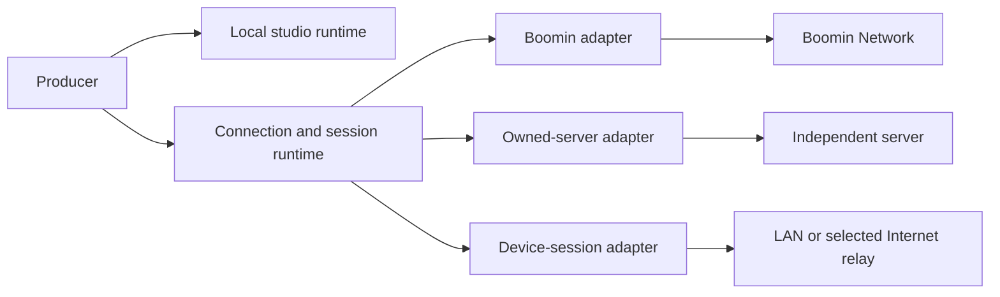

# Producer connection architecture: current state and proposed direction

Status: accepted product direction and proposed technical boundaries, November
8, 2026. This is not an implemented federation specification. The contained guest
recovery correction is in `037db9c`, capture-readiness recovery in `3caf3cd`, and
provider-aware branding in `b437891`. Local-first onboarding, portable native
authority and federation remain work to design and qualify. Development
coordination is in issue #131.

## Product boundary

Accepted product direction: **Producer** is the independent production studio.
**Boomin Network** is its first-party collaborative brand network. Boomin can provide
verified brands, discovery, relationships, messages, integrations and commercial
workflows while other servers provide their own services. White-labeling is a
later branding/distribution choice; it must not determine permission or hosting
boundaries.

Keep three separately testable layers:

1. **Local production:** room documents, device/source ownership, Set library,
   Set execution, MCP import/authoring, recording, virtual camera and selected
   streaming destinations.
2. **Portable collaboration:** issuer discovery, version/capability negotiation,
   invitations, admission, grants, room sessions, live events, media attachment,
   recovery and revocation. These contracts are usable by Boomin and independent
   hosts. WebRTC and existing media libraries remain the media foundation.
3. **Network services:** Boomin's brand network and independently hosted
   identity/directory/messaging services. Their optional capabilities sit above
   the common collaboration contract.

Target decomposition; the device and portable-native adapters still require
implementation and qualification:

## What exists

| Area | Current evidence | Remaining boundary |
|---|---|---|
| Local engine | Native SQLite room CRUD accepts an optional endpoint. Rendering, recording and RTMP output are local. | Startup, listings, ownership and some controls assume an endpoint. |
| Local Sets/MCP | External MCP compile, validate and preview use local files; native Set library uses local app data. | In-app hosted AI and live Set module execution require an endpoint. External model connectivity is separate from local MCP tools. |
| Boomin network | Workspace identity, mutual brand connections, room visibility, admission/grants/stage, durable conversations and realtime invalidations. | Verified relationships are Boomin-specific, not cross-server identity. |
| Boomin native media | Run/lease/epoch/generation fencing, scoped sessions, retirement, LiveKit transport. | The desktop native guest provider is pinned to Boomin's LiveKit project. |
| Self-hosted server | Single-owner primary token, room and guest capability links, admission/grants/stage and legacy P2P signaling. | No equivalent native run authority, directory, durable network inbox or general capability handshake. |
| Cross-issuer guest links | Desktop preserves the invitation issuer and omits the caller's account bearer. | Link participation does not establish a verified server relationship. Full real-device cross-server qualification remains pending. |
| Device-only hosting | Native production primitives exist. | No normal endpoint-free studio entry, local live-module authority or embedded guest signaling/rendezvous. |

The public self-hosted health contract (`0.1.0`) identifies the server; it does
not negotiate native media, messaging or identity features. A self-hosted
`producer_ref` is unverified display metadata, not a verified Boomin brand.

## Required connection matrix

Every direction below is a product requirement; the table distinguishes present
plumbing from the intended complete experience.

| Pair | Present state | Required result |
|---|---|---|
| Boomin ↔ Boomin | Real Mac-to-Windows composed Set and audible audio in both directions confirmed. Deliberate host restart exposed a client ticket bug; fix has focused tests but needs another paired run. | Verified consent, fresh media, unattended recovery and explicit placement/health. |
| Owned server ↔ Boomin | Issuer-preserving invitation path exists; arbitrary owned native providers are unsupported. | Both directions work without requiring the owned server to become Boomin or forwarding its owner token. |
| Owned server A ↔ owned server B | Legacy guest link path exists; federated identity/messages do not. | Both directions pass the same core protocol tests; optional features are negotiated. |
| Device-only Producer → Boomin/owned host | Anonymous guest authority exists on hosts; desktop entry still assumes a selected endpoint. | User can join by invitation from a local workspace, without first connecting an account/server. |
| Device-only host ← remote Producer | Not implemented. | Local owner can host with LAN pairing or a selected Internet rendezvous/media service, without mandatory account signup. |
| Device-only ↔ device-only | Not implemented. | Local discovery/pairing for LAN; explicit signaling/reachability strategy for Internet use. |

“No account” and “no infrastructure” are different requirements. Offline Set
work and local recording need no hosted service. Internet collaboration needs
signaling and may need STUN/TURN or an SFU. A managed default can hide the setup
from the creator while independent hosting remains possible. The rendezvous
service, room authority and media provider need not be the same operator.

## Local-first ownership is the first enabling change

Use a stable local workspace owner, separate from optional remote attachments.
Do not manufacture a server URL/token to make the current UI pass its checks.

`store.rs` currently claims NULL room/destination ownership for the first
connected endpoint on database open. Listing with no endpoint also means all
scopes. NULL therefore cannot become permanent device-only ownership unchanged.
A versioned migration must preserve existing workspace assignments and give
unassigned legacy work a deliberate local owner. Connecting or disconnecting a
server must not silently move/delete rooms, assets, recordings or stream keys.

Output start must validate an explicit selected workspace and destination set.
The current native go-live query selects every enabled destination; the local
mode must not inherit an all-scopes fallback. Local recording works, but catalog
listing needs local ownership support as well.

Local Set controls also need a real local authority adapter. Current live
modules require endpoint + server room, and rehearsal simulation is not the
same as live execution. Reuse the existing module command/snapshot contract for
device-supported controls. External social/data services stay explicitly
disconnected until configured; credentials remain in their own provider scope.

The desired first-run path is: create a local workspace → open a room → add
sources/import or author a Set → record or configure streaming. Connecting
Boomin Network or an owned server is an optional next step.

## Protocol boundary to specify before implementing federation

Keep these identities distinct: device, operator account, local workspace,
server issuer, remote workspace, persistent room, current room run, participant
and publication. A display handle is not a globally unique identity.

The first portable contract should define:

- Canonical issuer and versioned capabilities, including authority and media
  transport options, events and optional messaging/discovery features.
- Issuer-bound invitations and resumable join operations. Verified relationships
  and public/anonymous guest admission remain different authorization paths.
- A host-owned admission and grant state, separate from intended stage placement.
- Current run/host lease/epoch, participant generation, scoped media sessions,
  revocation and credential renewal. A retired run's ticket cannot authorize the
  next run; the still-admitted guest requests a fresh connection normally.
- Event sequencing, snapshots, stale-event rejection and reconnection semantics.
- Negotiated media provider configuration and trust/audience validation.
  Removing today's provider pin without replacing those checks is insufficient.
- Conformance fixtures for replay, duplicate joins, expired/revoked admission,
  host restart, provider loss and unsupported capabilities.

Account/owner bearer credentials never travel to another invitation issuer.
Any verified Boomin identity attachment must be explicit and scoped; an external
server cannot assert an arbitrary Boomin brand. Generic guest participation must
not require cloning Boomin's brand, commerce or CRM backend.

Persistent cross-server directory and direct messages can be documented
extensions of this contract. Their consent, blocks, ordering, delivery/read
receipts and revocation need their own tests. Guest audio conversation is not
that messaging layer.

## Common runtime and presentation ownership

The room model stores source recipes, logical slot assignments and intended
stage placement. An endpoint adapter supplies authorized roster/run facts.
The local media registry owns native capture and publication lifetimes. The Set
controller resolves bindings, prepares output and commits only validated frames.
React displays those facts and dispatches intent.

Each live source needs an incarnation and freshness facts independent of its
saved logical ID. Restoring `Guest 1` or the same camera name must not reconnect
a retired native source by accident. Current `has_frame` reflects nonzero
dimensions and is not proof of a fresh frame. The UI must distinguish admitted,
assigned to a slot, connected, waiting for frames, live, stalled and muted.

This is directly relevant to the current screenshots: Set restore can occur
before guest-source recreation; an unavailable-capture error previously blocked
automatic Set application even after that source returned. The bounded hook
recovery now in the branch handles observed missing→ready edges and preserves
current output; it does not solve indistinguishable same-ID source recreation.
Native source incarnation is the durable follow-up boundary.

The branch contains a native camera-detachment correction absent from installed
0.4.87. Windows investigation also identified unsaved camera device choices and
an unexpected Elgato virtual-camera input. Its bounded device-choice persistence
correction is integrated. On November 8 the Windows owner confirmed the physical
Elgato Facecam MK.2 remained selected and delivered current moving video after
leaving and reopening the room, supported by native device logs and the saved
device ID. That pass used frontend `b1bc461` and native core `fc4a252`; it does
not qualify the later merged native core, guest rebinding or host-run recovery.

The first local-workspace implementation is specified in
[LOCAL-STUDIO-OWNERSHIP.md](LOCAL-STUDIO-OWNERSHIP.md). It is a delivery boundary,
not an enabled local mode or a migration applied to production profiles.

## Performance and media scope

Render the local Set once and send composed media. The receiving Producer
places an ordinary authorized guest source, without running a second copy of
the sender's Set code or receiving its integration credentials. Track ownership,
capture leases, cancellation and generation checks must survive UI changes.

Current program capture is bounded at 960×540/20fps (portrait swaps dimensions),
uses a virtual-camera/canvas bridge and processed PCM, and is not a direct
native GPU publisher. Multiple outgoing connections can still need separate
encoders. The current mix-minus excludes all received guest audio, so forwarding
an entire multi-guest show requires destination-specific routing and audible
qualification. Current visiting mode also skips its local host roster; fully
hosting a local guest show while appearing elsewhere needs explicit independent
session owners, rather than another boolean on the room view.

Measure local restore, admission wait, capture, connection, publication and
first presented media separately. A saved ON flag, nonzero dimensions or an
existing admission must not count as recovered media. The new opt-in guest spans
report transport milestones; track availability is explicitly not first decode.
Local diagnostic recording should remain available without a server account;
sharing is a separate explicit choice of operator. Neither local production nor
an independent server connection should silently opt a creator into Boomin
telemetry delivery.

## Ordered delivery

1. **Paired baseline:** stable Mac/Windows dev profiles, exact frontend/native
   revisions, recovery fix, source readiness and stale-frame evidence. Keep
   production release ownership on Mac and freeze source during measured tests.
2. **Local workspace:** versioned ownership migration and no-account startup;
   local rooms, Sets/MCP, recording catalog and explicitly scoped RTMP output.
3. **Local live execution:** device-supported Set controls through a local
   authority adapter; connected data providers remain optional attachments.
4. **Portable contract and adapters:** agree on minimum capabilities and run the
   same authority/recovery tests against Boomin and the owned server.
5. **Cross-host parity:** prove both directions for server↔Boomin and
   server↔server with native provider/reachability configuration, then device
   guest entry without an account.
6. **Device hosting and optional federation:** LAN pairing, Internet rendezvous,
   then durable external relationships/messages under the documented extensions.

Before exposing a new mode, test clean install, offline restart, account attach
and detach, workspace switching, key/destination isolation, same-ID source
recreation, host restart, mute/revoke, first fresh video/audio and comparable
resource use. Ship the smallest qualified slice at each phase.

## Source anchors

- `src/App.tsx:41`: endpoint-gated entry.
- `src-tauri/src/store.rs:137`: legacy NULL ownership claiming.
- `src-tauri/src/live/commands.rs:217`: enabled destination selection.
- `src-tauri/src/recordings.rs:139`: endpoint-only catalog listing.
- `src/features/presentation/useSetModules.ts:15`: server-backed live modules.
- `src/features/sets-v2/useRoomOutput.ts`: bounded capture-readiness recovery.
- `src/lib/guestSeat.ts`: composed capture and server-selected guest transport.
- `src/lib/producerGuestRtc.ts`: native guest authority/recovery owner.
- `server/src/guests.ts:633`: unverified external producer reference.
- `server/src/live.ts:175`: self-host network relationship capabilities absent.
- Companion API `src/services/live/rtc-connections.ts` and migration 0173:
  connection tickets are run-bound; temporary host absence is distinct from
  revoked guest admission.

Protocol/reachability references: [WebRTC peer connections](https://webrtc.org/getting-started/peer-connections)
and [LiveKit self-hosted deployment](https://docs.livekit.io/transport/self-hosting/deployment/).
Developer coordination currently uses GitHub issue comments/commits, not a shared
WebSocket. [GitHub webhooks](https://docs.github.com/en/webhooks/about-webhooks)
could deliver change notifications to a future bridge; no bridge is deployed by
this design proposal.
