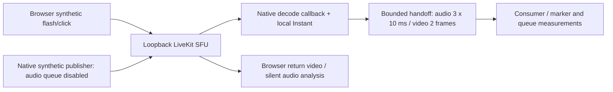

# Native guest RTC prototype

G0/G1 experiment on `prototype/livekit-g1-2026-10-09`, based on Producer `5723335`. This standalone native Rust lab establishes SDK, callback queue, and software APM behavior before modifying the Tauri/OBS room pipeline. It does not migrate any room or production service.

The [results and remaining gates](../../docs/LIVEKIT-G1-PROTOTYPE-RESULTS-2026-10-09.md) are the review entry point. Full dependencies and native archive checksums are in [the build manifest](evidence/build-manifest.json), Cargo.lock, and web/package-lock.json. LiveKit Rust is pinned to 0.9.4 with native-root Rustls WSS; JS is pinned to 2.22.4. The local SFU tested is 1.13.9.

The lab uses three small callback-access additions to the published libwebrtc 0.3.51 crate. See [vendor provenance](vendor/README.md). The upstream SDK hides those handles from consumers; an upstream supported callback hook is preferable for the product. The patch does not add original audio timestamps.



Camera and microphone access is unnecessary. Return audio is decoded and analysed with volume zero. Guests subscribe only to the native host in this fixture. This is a transport test, not the final direct-conversation plus composed-monitor subscription design, self-exclusion mixer, or private cue.

The synthetic reference feeds APM directly; it is not device playback. A production adapter must own actual capture and playback, and feed APM the final PCM scheduled to the speakers after destination routing, volume, resampling and mute. OBS's audience or stage return bus is not that reference. The prototype does not activate PlatformAudio or a second capture/playback owner.

## Run

From this directory, in separate terminals:

```sh
livekit-server --dev --bind 127.0.0.1
```

```sh
cd web
npm ci --no-audit --no-fund
node server.mjs
```

Build and test in a third terminal. Run transport tests sequentially: they share a fixed loopback room and native-host identity.

```sh
cargo build --locked --jobs 2
cargo test --locked --jobs 2
cargo clippy --locked --jobs 2 -- -D warnings
./target/debug/producer-guest-rtc-lab apm-fixture evidence/apm
cd web
node smoke.mjs 1 normal
node smoke.mjs 3 pressure
node smoke.mjs 3 republish
LIVEKIT_LAB_SECONDS=120 LIVEKIT_LAB_RUN_NAME=transport-3-pressure-120s node smoke.mjs 3 pressure
```

The macOS harness uses installed Google Chrome through Playwright Core; it downloads no browser. The CLI duration is bounded to 5–300 seconds. `pressure` skips consumer drain for 200 ms every five seconds while callbacks and the publisher keep running. `republish` disconnects guest 1, waits one second, and rejoins with its original identity. It is not an ICE restart or WAN outage test.

The server binds only to loopback and issues credentials only for fixed synthetic identities. `devkey`/`secret` are LiveKit's public development credentials. Nothing here is a production token issuer. Tokens, TLS keys, binaries and WAV/CSV intermediates stay under ignored runtime/evidence paths.

## WSS and Apple Silicon bundle

```sh
bash package-macos.sh
cd web
node make-tls.mjs
node tls-proxy.mjs
```

In another terminal, from the lab directory:

```sh
LIVEKIT_LAB_URL=wss://localhost:7884 \
SSL_CERT_FILE="$PWD/runtime/tls-ca.pem" \
LIVEKIT_LAB_RUN_NAME=transport-packaged-wss \
LIVEKIT_LAB_EXECUTABLE="$PWD/runtime/Producer Guest RTC Lab.app/Contents/MacOS/producer-guest-rtc-lab" \
node web/smoke.mjs 1 normal
```

This is an ad hoc signed CLI lab bundle with hardened runtime. It is not Developer ID signed/notarized, a Tauri UI integration, or a production Producer app. The TLS fixture creates a separate CA and end-entity certificate; trust is process-local through `SSL_CERT_FILE`. Certificate verification stays enabled and no keychain entry is installed. The saved negative TLS test rejects an untrusted issuer. This does not prove LiveKit Cloud credentials, refresh, or platform renewal.

## Speech fixture

The optional speech comparison uses macOS's offline Samantha voice. It does not play through the speakers.

```sh
say -v Samantha -o runtime/near-speech.wav --file-format=WAVE --data-format=LEI16@48000 \
  'Please keep listening while I speak clearly. We are checking that my voice stays natural when another person talks at the same time. The microphone should preserve every word.'
./target/debug/producer-guest-rtc-lab apm-fixture evidence/apm-speech runtime/near-speech.wav
```

The fixture processes 20 seconds of PCM offline, with echo paths at 40 and 67 ms. Measure far-only attenuation between 5 and 12 seconds, then double-talk from 14 to 20 seconds. It compares AEC disabled/enabled against identical samples, with NS, AGC and high-pass disabled. The near-signal projection searches processing delay; its gain and correlation are waveform measures, not perceived volume or word recognition. Shaped-noise and synthesized-speech results are both retained. Physical speakerphone, double-talk intelligibility and Bluetooth routing are unqualified.

## Timing limits

The media callback stamps decoded delivery before application queueing. Audio sample counts expose discontinuities when application frames are dropped. They do not recover the sender's original audio capture time. Video `ntp_time_ms` was zero in these runs. The flash/click fixture has up to one browser paint interval of source uncertainty; callback offsets are diagnostic, not recorded OBS lip-sync acceptance.

Queues evict the oldest frame when full, reject stale audio older than 30 ms and stale video older than 50 ms, and count callback lock contention. Audio callbacks copy a 10 ms block into an owned Vec, so allocation and real-time callback suitability remain to be qualified. This bounds the application's decoded handoff only; SDK encoder/network/jitter buffers remain outside these measurements.

Transport teardown removes sinks through RAII, aborts the publisher and clears its source buffer. Publication SIDs identify each track generation; stable guest identity keys measurements. An unsubscribe removes only the matching SID, so an old track's late teardown cannot remove its replacement. Retired queue evidence is saved. Admission, grants, host reclaim, source binding and private cue policies remain G2 work.

### Optional capture-time investigation

The native sink bridge now preserves optional WebRTC audio capture metadata. Run
`LIVEKIT_LAB_RUN_NAME=transport-timed-sink node web/smoke.mjs 1 normal` and
`LIVEKIT_LAB_RUN_NAME=transport-timed-republish node web/smoke.mjs 3 republish`
sequentially with the local SFU and fixture server running. The October 9 fixtures
supplied no audio capture timestamps and no video NTP metadata. See
[the timing investigation](../../docs/LIVEKIT-G1-AUDIO-TIMING-EXTENSION.md).
These runs still do not qualify OBS synchronization.
