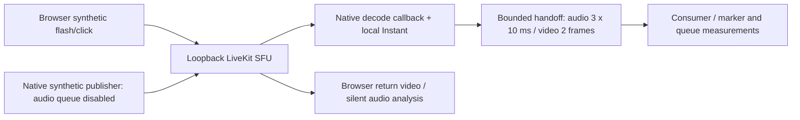

# Native guest RTC prototype

G0/G1 experiment on `prototype/livekit-g1-2026-10-09`, based on Producer `5723335`. This standalone native Rust lab establishes SDK, callback queue, and software APM behavior before modifying the Tauri/OBS room pipeline. It does not migrate any room or production service.

The [results and remaining gates](../../docs/LIVEKIT-G1-PROTOTYPE-RESULTS-2026-10-09.md) are the review entry point. Full dependencies and native archive checksums are in [the build manifest](evidence/build-manifest.json), Cargo.lock, and web/package-lock.json. LiveKit Rust is pinned to 0.9.4 with native-root Rustls WSS; JS is pinned to 2.22.4. The local SFU tested is 1.13.9.

The lab uses three small callback-access additions to the published libwebrtc 0.3.51 crate. See [vendor provenance](vendor/README.md). The upstream SDK hides those handles from consumers; an upstream supported callback hook is preferable for the product. The patch does not add original audio timestamps.



Camera and microphone access is unnecessary. Return audio is decoded and analysed with volume zero. Guests subscribe only to the native host in this fixture. This is a transport test, not the final direct-conversation plus composed-monitor subscription design, self-exclusion mixer, or private cue.

The synthetic reference feeds APM directly; it is not device playback. A production adapter must own actual capture and playback, and feed APM the final PCM scheduled to the speakers after destination routing, volume, resampling and mute. OBS's audience or stage return bus is not that reference. The prototype does not activate PlatformAudio or a second capture/playback owner.

## Run

From this directory, in separate terminals:

```sh
livekit-server --dev --bind 127.0.0.1
```

```sh
cd web
npm ci --no-audit --no-fund
node server.mjs
```

Build and test in a third terminal. Run transport tests sequentially: they share a fixed loopback room and native-host identity.

```sh
cargo build --locked --jobs 2
cargo test --locked --jobs 2
cargo clippy --locked --jobs 2 -- -D warnings
./target/debug/producer-guest-rtc-lab apm-fixture evidence/apm
cd web
node smoke.mjs 1 normal
node smoke.mjs 3 pressure
node smoke.mjs 3 republish
LIVEKIT_LAB_SECONDS=120 LIVEKIT_LAB_RUN_NAME=transport-3-pressure-120s node smoke.mjs 3 pressure
```

The macOS harness uses installed Google Chrome through Playwright Core; it downloads no browser. The CLI duration is bounded to 5–300 seconds. `pressure` skips consumer drain for 200 ms every five seconds while callbacks and the publisher keep running. `republish` disconnects guest 1, waits one second, and rejoins with its original identity. It is not an ICE restart or WAN outage test.

The server binds only to loopback and issues credentials only for fixed synthetic identities. `devkey`/`secret` are LiveKit's public development credentials. Nothing here is a production token issuer. Tokens, TLS keys, binaries and WAV/CSV intermediates stay under ignored runtime/evidence paths.

## WSS and Apple Silicon bundle

```sh
bash package-macos.sh
cd web
node make-tls.mjs
node tls-proxy.mjs
```

In another terminal, from the lab directory:

```sh
LIVEKIT_LAB_URL=wss://localhost:7884 \
SSL_CERT_FILE="$PWD/runtime/tls-ca.pem" \
LIVEKIT_LAB_RUN_NAME=transport-packaged-wss \
LIVEKIT_LAB_EXECUTABLE="$PWD/runtime/Producer Guest RTC Lab.app/Contents/MacOS/producer-guest-rtc-lab" \
node web/smoke.mjs 1 normal
```

This is an ad hoc signed CLI lab bundle with hardened runtime. It is not Developer ID signed/notarized, a Tauri UI integration, or a production Producer app. The TLS fixture creates a separate CA and end-entity certificate; trust is process-local through `SSL_CERT_FILE`. Certificate verification stays enabled and no keychain entry is installed. The saved negative TLS test rejects an untrusted issuer. This does not prove LiveKit Cloud credentials, refresh, or platform renewal.

## Speech fixture

The optional speech comparison uses macOS's offline Samantha voice. It does not play through the speakers.

```sh
say -v Samantha -o runtime/near-speech.wav --file-format=WAVE --data-format=LEI16@48000 \
  'Please keep listening while I speak clearly. We are checking that my voice stays natural when another person talks at the same time. The microphone should preserve every word.'
./target/debug/producer-guest-rtc-lab apm-fixture evidence/apm-speech runtime/near-speech.wav
```

The fixture processes 20 seconds of PCM offline, with echo paths at 40 and 67 ms. Measure far-only attenuation between 5 and 12 seconds, then double-talk from 14 to 20 seconds. It compares AEC disabled/enabled against identical samples, with NS, AGC and high-pass disabled. The near-signal projection searches processing delay; its gain and correlation are waveform measures, not perceived volume or word recognition. Shaped-noise and synthesized-speech results are both retained. Physical speakerphone, double-talk intelligibility and Bluetooth routing are unqualified.

## Timing limits

The media callback stamps decoded delivery before application queueing. Audio sample counts expose discontinuities when application frames are dropped. They do not recover the sender's original audio capture time. Video `ntp_time_ms` was zero in these runs. The flash/click fixture has up to one browser paint interval of source uncertainty; callback offsets are diagnostic, not recorded OBS lip-sync acceptance.

Queues evict the oldest frame when full, reject stale audio older than 30 ms and stale video older than 50 ms, and count callback lock contention. Audio callbacks copy a 10 ms block into an owned Vec, so allocation and real-time callback suitability remain to be qualified. This bounds the application's decoded handoff only; SDK encoder/network/jitter buffers remain outside these measurements.

Transport teardown removes sinks through RAII, aborts the publisher and clears its source buffer. Publication SIDs identify each track generation; stable guest identity keys measurements. An unsubscribe removes only the matching SID, so an old track's late teardown cannot remove its replacement. Retired queue evidence is saved. Admission, grants, host reclaim, source binding and private cue policies remain G2 work.

### Optional capture-time investigation

The native sink bridge now preserves optional WebRTC audio capture metadata. Run
`LIVEKIT_LAB_RUN_NAME=transport-timed-sink node web/smoke.mjs 1 normal` and
`LIVEKIT_LAB_RUN_NAME=transport-timed-republish node web/smoke.mjs 3 republish`
sequentially with the local SFU and fixture server running. The October 9 fixtures
supplied no audio capture timestamps and no video NTP metadata. See
[the timing investigation](../../docs/LIVEKIT-G1-AUDIO-TIMING-EXTENSION.md).
These runs still do not qualify OBS synchronization.

### Actual OBS recording experiment (macOS)

Start the loopback SFU, then start `LIVEKIT_LAB_SYNC_STREAMS=1 node web/server.mjs`.
This creates only the fixed local `producer-g1-sync-lab` room with syncStreams enabled;
paired camera/audio publications use `camera-av` and program return uses `program-av`.
The setting disables transceiver reuse upstream; frequent subscription changes need
separate qualification. The normal fixture leaves this setting disabled.

Build with `cargo build --locked --jobs 2 --features obs-proof`. The diagnostic
recorder requires the installed Producer OBS 32.1.2 engine; it loads only x264,
ffmpeg and CoreAudio encoder modules. It captures no physical camera/microphone and
plays no audio. Place a symlink to `/Applications/Producer.app/Contents/MacOS/obs-ffmpeg-mux`
at `target/debug/obs-ffmpeg-mux` for the standalone muxer helper. The process retains
a macOS main run loop while the engine/RTC work executes off the main thread.

```sh
DYLD_FRAMEWORK_PATH=/Applications/Producer.app/Contents/Frameworks \
DYLD_LIBRARY_PATH=/Applications/Producer.app/Contents/Frameworks \
LIVEKIT_LAB_SYNC_STREAMS=1 \
LIVEKIT_LAB_OBS_RECORDING="$PWD/runtime/obs-test.mp4" \
LIVEKIT_LAB_RUN_NAME=transport-obs-test node web/smoke.mjs 1 normal
swiftc -suppress-warnings analyze-recording.swift -o runtime/analyze-recording
runtime/analyze-recording runtime/obs-test.mp4 evidence/obs-test-markers.json
```

Choose an unused runtime filename; the recorder refuses to overwrite. It records
only guest-1 and stamps audio/video using one OBS monotonic anchor plus callback
Instant elapsed. `LIVEKIT_LAB_OBS_UNBUFFERED=1` disables OBS async video buffering
for a comparison. This is an arrival-clock experiment, not a validated sender
presentation clock. AVFoundation decodes the actual MP4, pairs markers at most once,
and reports unpaired markers, early/late drift, detector windows and source paint
uncertainty. A passing marker result alone cannot qualify WAN impairment or G1.

### Local playout clock and dedicated audio ingest

`LIVEKIT_LAB_PLAYOUT_CLOCK=1` anchors native video render timestamps using
WebRTC TimeMicros and one local Instant; invalid timestamps fall back to arrival
with visible counters. Audio follows its 48 kHz sample progression until callback
arrival differs by more than 30 ms, then reanchors and counts the reset. This is a
receiver playout experiment, not sender capture synchronization. Each new track SID
owns fresh clock state. OBS audio now drains a separate three-block/30 ms queue on
a dedicated worker; audio callback copies use fixed 480-sample arrays. Sink removal
and worker join precede OBS stop/source release. Pressure mode stalls the video and
analysis consumer while the independent audio worker continues. Source/SDK/device
buffers outside these queues remain unmeasured.

The smoke runner's `network` mode can request global Chrome CDP rules with packet
loss/reordering and 60 ms latency. Use `LIVEKIT_LAB_PACKET_LOSS=100` as a hard-loss
control. The October 9 control continued receiving 199 return-audio packets in four
seconds and native receivers reported zero packet loss. Thus CDP acknowledgement
did not prove impairment on this tested media path. Those runs must not be counted
as WAN/network acceptance. Rules are scoped to the disposable headless browser;
no system firewall or production network settings are altered.

### Verified packet-level impairment

Start the isolated SFU with loopback ICE candidates and TCP disabled:

```sh
livekit-server --dev --bind 127.0.0.1 --rtc.enable_loopback_candidate --rtc.tcp_port 0
LIVEKIT_LAB_SYNC_STREAMS=1 LIVEKIT_LAB_PACKET_PROXY=1 node web/server.mjs
LIVEKIT_LAB_PACKET_PROFILE=baseline node web/packet-proxy.mjs
```

The relay terminates loopback signaling at port 7885 and rewrites the fixed SFU UDP
candidate to a loopback NAT at 7883, forwarding encrypted datagrams to 7882. It
rejects TCP and non-mux candidates to prevent bypass. ICE/DTLS/RTCP are unimpaired;
it classifies the fixture's negotiated Opus payload type 111 as audio and other RTP
as video. This classifier is specific to the synthetic fixture, not a generic
production RTP classifier. No media payload is decrypted or logged.

Restart the relay for each run/profile; it bounds peers to 16 and delayed packets
to 1024. Initial signaling buffers are capped at 64 messages/128 KiB, connected
WebSocket backpressure at 1 MiB. All sockets/timers have a process shutdown path.
The SFU is a local lab process; `--bind` alone does not bind RTC to loopback, so
loopback candidates must be explicitly enabled. System networking is unchanged.

Use `LIVEKIT_LAB_URL=ws://127.0.0.1:7885` for native smoke runs. `hard-loss` relay
profile plus smoke mode `hard-loss` must suppress all return markers while counting
media drops and continuing control traffic. `video-jitter` delays each video packet
20–119 ms and drops approximately 2%; `audio-jitter` delays audio 20–79 ms and drops
approximately 2%. Both directions are affected on the selected media class, so a
browser-to-native path crosses two impairment legs. A seeded PRNG selects events;
exact packet order depends on scheduling. Return RTP and retransmissions are also
affected. Relay packet counters are saved alongside smoke evidence.

The fixture tokens include sync room configuration so recreating an empty room does
not silently lose stream grouping. `churn` smoke mode rejoins guest-1 three times;
use a duration of at least 35 seconds. Audio generations now retire their sinks and
join the old writer before a replacement writer starts. Final worker counts and
per-generation/session handoff counters include retired generations.

```sh
node web/verify-ingest-accounting.mjs \
  evidence/transport-obs-packet-accounting.json evidence/ingest-accounting-verification.json
```

This checks the quiescent accounting invariant for every generation: received equals
consumed plus overflow/contention/stale drops plus the pending shutdown tail.
Pending samples at teardown are recorded rather than credited as consumed. It also
checks source sink removal, successful worker exit, no overlapping writers for the
single guest-1 OBS source, and zero application ingest workers after retirement.
Native SDK device/thread cleanup and G2 private-cue queue flushing remain separate.

### Decoded timing mixer probe

Set `LIVEKIT_LAB_TIMED_MIXER=1` on the native fixture to install the optional
custom AudioMixer. The probe delegates normal PCM processing and records RTP,
NTP, elapsed time, rate/channels/sample count and local pull observations after
GetAudioFrameWithInfo returns. `timed_mixer_probe` in transport evidence includes
retired source generations, live/created/destroyed wrapper counts and explicit
contention/capacity counters. No timing from this probe feeds OBS yet.

Run `python3 labs/guest-rtc/native/test-timed-mixer.py` from the worktree root after
building the lab. It links the already-present pinned native archive and executes
100 ownership/delegation cycles without downloading a new WebRTC checkout.
Source metadata availability, source-to-track association and OBS timing remain
separate proofs. See [the updated timing bridge investigation](../../docs/LIVEKIT-G1-PLAYOUT-BRIDGE-SPEC.md).

`LIVEKIT_LAB_RRTR=1` is an opt-in native SDP experiment, documented in the bridge
investigation. It augments native local/remote audio feedback copies, leaves video
untouched and does not rewrite SDK signaling payloads. Current evidence shows no
valid frame NTP improvement; effective XR exchange is not verified. Keep it confined
to this local SFU fixture. Run `python3 labs/guest-rtc/native/verify-timed-mixer.py`
to validate the saved live probe evidence and source-wrapper retirement.

### Native RTCP exchange probe

Enable `LIVEKIT_LAB_RTCP_PROBE=1` with the mixer probe to observe authenticated
RTCP clock fields and requests/replies. The wrapper forwards normal logger events
and retains bounded XR and sender-report histories, never raw packets or media.
One log instance may span multiple peer connections; the legacy `peers` field is
a log-instance list. Explicit ring-overwrite, contention and capacity counters
limit what may be inferred from retained histories.

`python3 labs/guest-rtc/native/test-timed-mixer.py` now validates both mixer and
log lifetimes and writes `evidence/rtcp-probe-lifecycle.json`.
`python3 labs/guest-rtc/native/verify-rtcp-exchange.py` checks the three saved
transport runs, request/reply behavior, control relay and sender-report clock pairs.
Current evidence proves outgoing RTT requests with no incoming replies; the SSRC
routing cause remains a source-supported hypothesis. Report maps have not been
connected to OBS or qualified for synchronized presentation.

The `sender_report_origin_maps` diagnostic fits fresh incoming sender reports and
reconstructs the latest decoded audio RTP origin in sender-NTP time. It is evaluated
after the run, has explicit age/slope/wrap/discontinuity guards, and does not feed
OBS. The saved three-guest rejoin run demonstrates six current report maps and
three audio origins without enabling RRTR. This remains timing metadata evidence,
not synchronized playback or original capture-time qualification.

### Paired PCM handoff

With the mixer and RTCP probes enabled, transport drains a typed, bounded decoded
PCM handoff and maps each block's RTP timestamp online. `decoded_pcm_origin_handoff`
reports per-generation consumption, clock availability, sequence gaps, nonzero PCM
counts and up to 16 mapped origins. Mono and stereo 48 kHz, 480 samples per channel
are preserved; no downmix or inferred capture timestamp is introduced. The native
pull uses fixed arrays and try-lock; polling owns allocations and serialization.

The lifecycle script now writes `evidence/decoded-pcm-lifecycle.json` and adds
paired PCM, stereo, overflow, stale, contention, retirement and accounting checks.
Run `python3 labs/guest-rtc/native/verify-decoded-pcm.py` to validate saved stereo
rejoin and audio-jitter runs. The initial mono-only format failure is retained in
`transport-decoded-pcm-rejoin.json`. OBS has not switched to this handoff, so these
runs qualify metadata delivery and online mapping only.

On macOS with limited build space, set
`LIVEKIT_LAB_LINK_EXTERNAL_ARCHIVE=1` on every Cargo invocation. The isolated
vendor build then links the same pinned `libwebrtc.a` at the executable link step
rather than embedding another roughly 700 MiB copy in the Rust archive. Keep the
native archive in place; no WebRTC implementation or runtime behavior changes.
The default upstream bundling behavior remains available without this lab option.

### Opt-in continuous audio-master / raw pipeline experiment

The previous callback clock remains the default lab path. To feed OBS paired
native PCM, build with `LIVEKIT_LAB_LINK_EXTERNAL_ARCHIVE=1 cargo build --locked
--jobs 2 --features obs-proof`; this macOS opt-in links the pinned WebRTC archive
externally to avoid a second large Rust archive copy. Keep the native archive
available for the final linker. Use the environment and unused recording filename
from the OBS example above, plus:

```sh
LIVEKIT_LAB_TIMED_MIXER=1
LIVEKIT_LAB_RTCP_PROBE=1
LIVEKIT_LAB_AUDIO_MASTER=1
LIVEKIT_LAB_SCHEDULE_HANDOFF=1
LIVEKIT_LAB_OBS_PIPELINE_PROBE=1
```

Export these variables or pass them inline to the smoke command. Audio-master
requires both native probes and an OBS recording. Scheduled handoff requires
audio-master; it bounds application queues and decouples/unbuffers async video.
The raw pipeline flag observes the lab's fixed NV12 320×180 mix and float-planar
48 kHz audio with bounded marker storage. It captures no physical devices and
plays no audio. `obs-lifecycle <evidence-file>` checks repeated recorder/probe
finish and cancellation. `python3 native/verify-audio-master.py` checks saved
recordings, native block accounting, presentation queue retirement and probe
cleanup while preserving local synchronization failures.

This experiment is unqualified: jitter still fails the recorded 80 ms gate,
startup waits for two sender reports, and raw-mix versus recording offsets need
encoder/muxer investigation. See the October 10 checkpoint in
[prototype results](../../docs/LIVEKIT-G1-PROTOTYPE-RESULTS-2026-10-09.md).

### Pre-mux timing and independent audio decoding

The raw pipeline option also installs a synchronous OBS output packet callback.
It copies timestamps only, with an 8,192-entry cap and try-lock; the recorder
unregisters it before releasing the output. Its lifecycle workload includes an
injected failure after packet registration. The lab samples AAC priming while the
encoder is active, because OBS destroys encoder context data on stop.

```sh
python3 native/build-audio-decoder.py
swiftc -suppress-warnings inspect-container.swift -o runtime/inspect-container
runtime/inspect-container runtime/example.mp4 evidence/example-container.json
DYLD_LIBRARY_PATH=/Applications/Producer.app/Contents/Frameworks \
  runtime/decode-audio-markers runtime/example.mp4
python3 native/compare-decoders.py
python3 native/verify-packet-timing.py
```

The decoder builder fetches only FFmpeg 7.1.1 headers into ignored runtime storage;
it requires the installed Producer libraries to report `n7.1.1`. Compressed sample
timing is read without decoding by the Swift inspector. The independent C decoder
reads the synthetic audio file using FFmpeg, with explicit packet/frame/context
cleanup; it captures and plays nothing. Comparisons preserve archived AVFoundation
failures instead of replacing them with another decoder's results.

`LIVEKIT_LAB_OBS_FINALIZED_MP4=1` selects `movflags=faststart` in the lab for container
comparison. It requires successful finalization and is not a crash recovery policy.
Fragmented MP4 remains the default and production configuration. The observed
cross-decoder disagreement disappears in the finalized comparison, but jitter and
missing video markers still prevent G1 qualification.

The opt-in external archive build now also passes macOS linker `-S`, avoiding a
large temporary binary containing unused upstream native debug symbols. Disk-full
recordings and failed links are excluded from synchronization evidence.


### First-report startup experiment

`LIVEKIT_LAB_FIRST_REPORT_BOOTSTRAP=1` is an opt-in audio-master lab experiment.
It maps the first fresh authenticated sender report using the fixture's explicit
48 kHz audio / 90 kHz video rates, for at most five seconds of report age and RTP
extrapolation. A second plausible report switches to the measured slope. A detected
report discontinuity disables bootstrap for that clock until a fresh pair exists.
It uses no arrival-time or previous-publication fallback. The default still requires
two reports. Playback evidence labels the policy and counts audio/video bootstrap
usage; the separate decoded-origin diagnostic continues to measure two-report maps.

The first rejoin test reduced startup suppression but missed seven video markers;
a separate jitter run passed locally. This experiment is not qualified for adoption
or production. Synthetic timing does not qualify physical speakerphone AEC.


### Sender labels and experimental composition buffering

Playback now retains up to 192 numeric audio label observations. It measures the
sender-origin advance relative to the continuous PCM sample clock, saving quarter-
second observations, bootstrap transitions and large steps. It stores no media.
The trace resets its reference at publication binding changes and new generations;
audio reanchors now start a new trace epoch, including within one generation, so a scheduling reset cannot appear as source-clock drift in new evidence. Older reports retain their original measurements.
Use the explicit clock-reset counters when interpreting that result.

`LIVEKIT_LAB_EXTENDED_VIDEO_BUFFER=1` is a separate opt-in experiment: scheduled
composition permits video deadlines up to 400 ms ahead and owns at most 14 pending
frames for this fixed 30 fps fixture. Default behavior remains 250 ms / eight
frames; the callback ingress queue is separate. Evidence reports maximum/mean
accepted video lead, queue capacity, drops and post-shutdown accounting. This is a
composition-latency tradeoff, not a qualified conversation playback policy. It
changes neither audio presentation delay (120 ms) nor the 80 ms marker sync gate.

Audio-jitter/rejoin recordings matched all markers with the experimental buffer,
while a separate default-buffer run missed two matches. Default-buffer rejoin
recordings have also passed on other runs, so this does not establish causal or
universal improvement. Startup waiting, clock reanchors, true capture timing,
physical AEC and packaged platform tests remain outstanding. Neither experiment
is enabled in production.

### Startup and rejoin milestones

Playback retains up to 64 numeric startup milestones across binding epochs:
audio/video SSRC binding, first bound PCM, usable audio/video clock maps, and first
scheduled audio/video. Each milestone records its first observation only. PCM pull
time and application observation time are explicitly separate; these measurements
are neither capture latency nor speaker playout latency. Publication events trigger immediate binding discovery, but events can precede
usable inbound SSRC stats. Discovery runs as one owned Tokio task, with at most
two current publication clones, 100 ms per-track stats timeout and 250 ms overall
timeout. The presentation tick only polls completed results. Binding changes abort
old discovery; results must match the binding epoch and current publication SID.
Shutdown aborts and joins all discovery work before retiring the room. Evidence
reports task completion/cancellation/timeouts and verifies zero active jobs after
shutdown. Unsuccessful discovery retains a 500 ms retry.

The trace also separates first incoming audio/video sender-report arrival from
usable clock/PCM availability. Arrival milestones match current SSRC, incoming
reports and binding epoch; they are observations, not proof that a report gives a
usable mapping. Sender-report waiting and physical AEC remain open.

Low-disk build recovery: if macOS `rust-objcopy` exhausts disk while doing the
redundant post-link stripping pass, check executable type and size rather than
trusting Cargo's exit status. The lab linker already strips native DWARF. Override
stripping only for this final crate with
`LIVEKIT_LAB_LINK_EXTERNAL_ARCHIVE=1 cargo rustc --locked --jobs 2 --features obs-proof -- -C strip=none`.
Changing the whole Cargo profile instead rebuilds dependencies and uses more disk.
